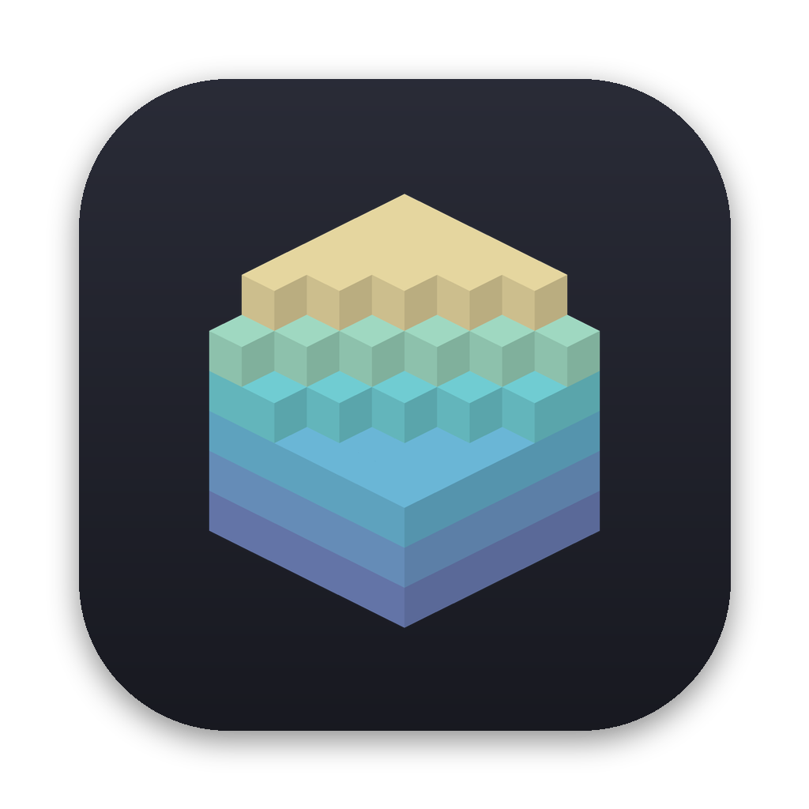
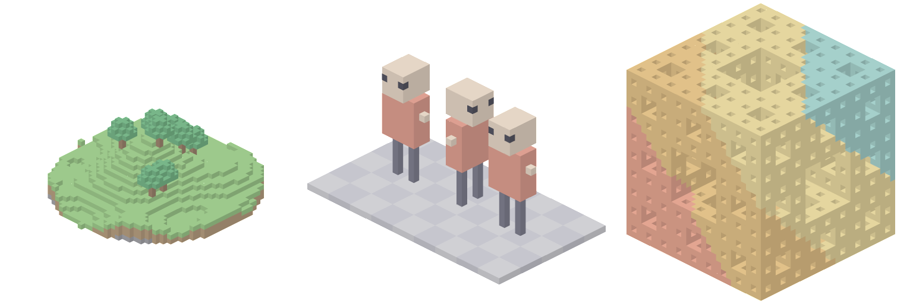

<p align="center"></p>

<h1 align="center">VoxLook</h1>

<p align="center">Quick Look for MagicaVoxel <code>.vox</code> files on macOS.<br>
Finder thumbnails, and a 3D preview you can spin when you press Space.</p>

<p align="center"></p>

## What it does

- **Thumbnails.** Finder icons, column view and Get Info show the model itself, not a blank document.
- **Space-bar preview.** An orbitable 3D view with the model's size and voxel count. Drag to turn it, scroll or pinch to zoom.
- **Whole scenes.** It reads MagicaVoxel's scene graph: multiple models, groups, rotations, mirroring and the palette. Hidden layers and hidden objects are left out.
- **Light on the battery.** Faces are greedy-meshed, and a model used many times is meshed once. The preview redraws only while you interact with it and uses no CPU while it sits open. Thumbnails take about 20–60 ms each, and Quick Look caches them.
- **Sandboxed.** Both extensions only read the file they're given.

Requires macOS 14 or later.

## Install

Build from source. You need Xcode and [XcodeGen](https://github.com/yonaskolb/XcodeGen) (`brew install xcodegen`).

```sh
git clone https://github.com/Springfolk/voxlook.git
cd voxlook
make install        # builds, copies VoxLook.app to /Applications, registers the extensions
```

Then select a `.vox` file in Finder and press Space. If nothing happens, open VoxLook once and check that both extensions are enabled in **System Settings → General → Login Items & Extensions → Quick Look**.

By default the build is signed ad hoc, which is enough on your own Mac. To sign with your team, create `Config/Local.xcconfig`:

```
DEVELOPMENT_TEAM = ABCDE12345
CODE_SIGN_IDENTITY = Apple Development
CODE_SIGN_STYLE = Automatic
```

`make uninstall` removes it again.

## Command line

`voxthumb` renders any `.vox` to a PNG through the same code path as the Finder thumbnails:

```sh
swift run -c release voxthumb model.vox model.png 1024
```

## Using the library

The package exposes `VoxKit` (parser, scene graph, mesher; Foundation only) and `VoxRender` (SceneKit scene, offscreen renderer, preview view):

```swift
.package(url: "https://github.com/Springfolk/voxlook.git", from: "1.0.0")
```

```swift
let file = try VoxFile(contentsOf: url)
let mesh = file.models[0].mesh(palette: file.palette)   // positions, normals, colours, indices
let image = try VoxThumbnailRenderer.render(contentsOf: url, pixelSize: CGSize(width: 512, height: 512))
```

## Not yet

- Materials (glass, emission, metal) are drawn as plain colour.
- Animations show their first frame.

## Contributing

Issues and pull requests are welcome. `make test` runs the suite. The test fixtures are built in code, so no third-party models live in the repo. See [docs/](docs/) for how it works.

## Licence

[MIT](LICENSE). MagicaVoxel is made by [ephtracy](https://ephtracy.github.io); VoxLook isn't affiliated with it.
